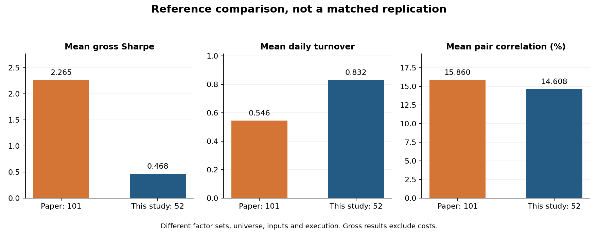
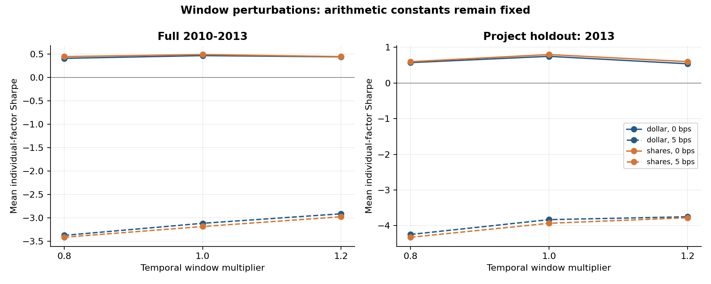
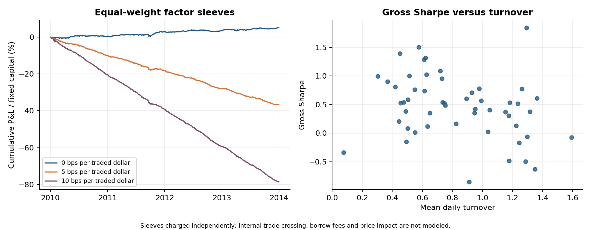
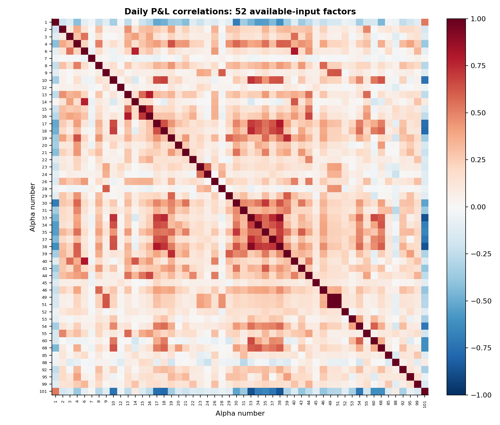

# Just Alpha101：一次有边界的复现

## 我想回答的问题

我把这次研究拆成三个问题：101 个表达式能否正确变成代码？公开数据能支持多少个因子？在明确的执行和成本假设下，论文中的表现与统计规律还剩多少？这三个问题不能相互替代。

**当前结论：101 个公式已实现，但严格数据验收未通过，尚未达到原论文的收益效果。** 本次真实数据实验能计算 52 个因子，另有 49 个因缺失字段而跳过。没有用随机数据、HLC3 或当前行业来填补实证缺口。

## 数据和验收

数据来自历史 Quandl WIKI 存档的 Kaggle 镜像。先按 2009 年原始收盘价乘成交量的均值预选 500 只股票，再保留完整历史的 486 只，得到 857,304 条记录。另有 14 只被排除，详见 [股票池清单](universe.csv)。预选流动性只用 2009 年信息，**完整历史筛选使用了未来存续信息，存在幸存者偏差**；这使本实验适合诊断实现和敏感性，不能作为无偏策略收益。

评估窗口为 2010-01-04—2013-12-31，共 1006 个入场日。最后一个区间在 2014-01-02 开盘结束。论文没有披露足以精确匹配的交易区间和股票池。输入含 2007 年以来预热历史，严格检查评估前最近 500 个交易日。

| 检查 | 状态 | 说明 |
|---|---|---|
| calendar | 通过 | 1006 observed sessions, 1006 expected XNYS sessions |
| complete_panel | 通过 | Conservative full-panel requirement; incomplete or changing membership needs a separately audited membership-aware adapter |
| true_vwap | 未通过 | Requires actual daily trade-volume weighted price; OHLC proxies do not qualify |
| true_dollar_volume | 未通过 | Raw close times volume is explicitly a proxy, not actual traded dollar value |
| historical_market_cap | 未通过 | Historical market capitalization is required for Alpha 56 |
| point_in_time_industry | 未通过 | Historical sector/industry/subindustry needed for 18 neutralized formulas |
| corporate_actions | 通过 | Source-adjusted OHLCV must have documented split/dividend conventions |
| membership_and_delistings | 未通过 | No complete delisting coverage is inferred merely from a large symbol count |
| point_in_time_adjustments | 未通过 | Retrospectively adjusted data are not proof of as-known-on-date input values |
| warmup | 通过 | Last 500 XNYS sessions immediately before evaluation required per symbol; minimum observed 500; each factor also enforces full rolling windows |
| provenance_file_binding | 通过 | The source metadata processed_sha256 must identify this exact input; claims still need source verification |

存档 SHA-256：`adfd226694c6f3ec2c56b585d973764180a39a3ec516601721e90096dc1de94f`。原始行情和处理后行情留在本地，仓库仅保留来源、哈希及派生实验结果。镜像并不是数据提供商的审计认证。

## 方法和防止自我欺骗的约定

每个交易日对信号去截面均值，再按绝对值和归一到总敞口 1；收盘形成信号，下一开盘交易，到再下一开盘计算收益。资金分母保持固定，年化收益为日均 P&L×252，不是 CAGR。换手采用漂移调整后的买卖金额绝对值之和，没有除以二。成本为成交金额每单边 0、5、10 bps；未包括借券费、冲击和融资费，也没有逐标的容量约束。期末保留持仓，未额外收取平仓费。

论文的 42、48、53、54 为 delay-0，本项目统一保守延迟；可计算的 53、54 因而不是原执行假设。算子中的并列排名、极值索引及标准差自由度是公开说明的实现约定，不能假称为未披露的原作者配置。

六组候选为窗口倍率 0.8、1.0、1.2 × 美元成交额代理/成交股数 ADV。**只改变时序算子与 ADV 的窗口，公式中的算术常数保持不变**，例如 `sum(close,8)/8` 在 0.8 倍率下是 `sum(close,6)/8`，不是六日均价。因此这叫算子窗口扰动，而非纯均线周期优化。

2010—2012 为开发描述区间，跨入 2013 的收益区间被剔除；2013 为本项目保留评估区间。不按 2013 选择赢家，全部候选均报告。原公式 2016 年公开且可能已在 2013 年数据上开发，所以这里不是对原始因子的真正事前样本外证明。候选配置是在本项目首次回测前固定，未作第三方公开预注册。

## 实际结果

| 统计量 | 论文表格 | 本项目诊断样本 |
|---|---|---|
| 因子数量 | 101 | 52 |
| 平均 Sharpe（毛） | 2.265 | 0.468 |
| 平均日换手 | 0.5456 | 0.8319 |
| 平均持有期（1/换手，天） | 2.391 | 1.625 |
| 平均年化算术收益 | 6.015% | 1.279% |
| 平均两两相关性 | 15.86% | 14.61% |
| 收益—波动率对数回归斜率 | 0.761 | 0.532 |
| cents-per-share | 0.4814（平均） | 不报告：未重建未复权成交股数 |

以上是不同样本与执行条件下的描述性对照，**不是统计上的通过/失败同口径检验**。完整的分位数、相关性和回归见 [机器可读结果](paper_comparison.json)。尤其是相关性均值接近，并不代表收益、每个因子的表现或所有 101 个因子都复现了。

| 方案 | 区间 | 单边成本 bps | 因子平均 Sharpe | 因子平均年化算术收益 |
|---|---|---|---|---|
| dollar_w0.8 | full_2010_2013 | 0 | 0.410 | 1.07% |
| dollar_w0.8 | full_2010_2013 | 5 | -3.371 | -9.45% |
| dollar_w0.8 | holdout_2013 | 0 | 0.572 | 1.13% |
| dollar_w0.8 | holdout_2013 | 5 | -4.246 | -9.35% |
| dollar_w1 | full_2010_2013 | 0 | 0.468 | 1.28% |
| dollar_w1 | full_2010_2013 | 5 | -3.113 | -9.20% |
| dollar_w1 | holdout_2013 | 0 | 0.748 | 1.61% |
| dollar_w1 | holdout_2013 | 5 | -3.831 | -8.82% |
| dollar_w1.2 | full_2010_2013 | 0 | 0.442 | 1.24% |
| dollar_w1.2 | full_2010_2013 | 5 | -2.910 | -8.72% |
| dollar_w1.2 | holdout_2013 | 0 | 0.540 | 0.78% |
| dollar_w1.2 | holdout_2013 | 5 | -3.750 | -9.12% |
| shares_w0.8 | full_2010_2013 | 0 | 0.447 | 1.23% |
| shares_w0.8 | full_2010_2013 | 5 | -3.411 | -9.50% |
| shares_w0.8 | holdout_2013 | 0 | 0.598 | 1.25% |
| shares_w0.8 | holdout_2013 | 5 | -4.324 | -9.42% |
| shares_w1 | full_2010_2013 | 0 | 0.491 | 1.37% |
| shares_w1 | full_2010_2013 | 5 | -3.181 | -9.34% |
| shares_w1 | holdout_2013 | 0 | 0.799 | 1.75% |
| shares_w1 | holdout_2013 | 5 | -3.933 | -8.90% |
| shares_w1.2 | full_2010_2013 | 0 | 0.447 | 1.24% |
| shares_w1.2 | full_2010_2013 | 5 | -2.973 | -8.93% |
| shares_w1.2 | holdout_2013 | 0 | 0.599 | 1.21% |
| shares_w1.2 | holdout_2013 | 5 | -3.777 | -8.93% |

完整 0/5/10 bps、开发期与保留期、每个因子的结果保留在 [metrics.csv](metrics.csv)，共 2,808 行；未只挑选获利的因子。各候选使用同一诊断股票池。

## 我从差距中得到的理解

1. **表达式不是可交易策略的全部。** 相同的公式，经过不同股票池、排名约定、持仓映射和执行延迟后，会形成不同收益。实现通过测试不能证明实证达到原文。
2. **量纲检查能发现有价值的问题。** 原文 ADV 定义为美元成交额，但 Alpha7 与成交股数比较。在本基线中，Alpha7 虽然信号覆盖率为 100.0%，实际仅 43 / 1006 天有持仓。大量相同常数在去均值后变成现金。完整的数组并不等于有效交易信号。
3. **成本比一个漂亮的毛 Sharpe 更接近交易现实。** 日换手较高时，即使每单边只有几个基点，平均年化成本也会超过平均毛收益；这不是说每个因子都在同一成本下亏损。这里没有内部交叉抵消交易，所以等权因子组合的成本采用各独立子组合成本加总；不能据此断言原论文的实际组合无法获利。
4. **接近一个数字不等于接近研究结论。** 相关性均值相似可能掩盖不同的分布、极值和因子集合，必须同时看收益、换手、相关矩阵和覆盖率。
5. **参数改变不应被包装成改进。** 六组候选差异是敏感性结果；若只发布最好的窗口，会高估稳定性。这里保留所有候选，没有用负收益的绝对值做回归，也没有删掉不赚钱的因子。

## 论文统计关系的复核

| 回归 | 有效样本 | 排除数 | R² | 系数 |
|---|---|---|---|---|
| return_volatility | 43 | 9 | 0.0531 | intercept=-6.4883, log_daily_volatility=0.5322 |
| return_volatility_turnover | 43 | 9 | 0.0533 | intercept=-6.3998, log_daily_volatility=0.5481, log_turnover=-0.0400 |
| volatility_turnover | 52 | 0 | 0.0145 | intercept=-6.2328, log_turnover=0.1062 |
| correlation_turnover | 1326 | 0 | 0.0068 | intercept=0.1461, log_turnover_sum=0.0064, log_turnover_product=0.0678 |

对数收益回归只包含正日均收益因子；当前非正均值收益因子数为 9，明确排除而不取绝对值。因此回归同样存在选择条件，不能与原文全为正收益的 101 个因子直接等价。相关性回归的两个因子对解释变量进一步去均值，因此截距等于样本平均相关性；这不改变斜率与 R²，但属于本项目的额外中心化约定。因子对并不独立，常规 OLS 的 p 值只能作为描述输出，不能当作稳健推断。

## 还差什么，怎样继续

要进一步接近原始口径，需要可核验的历史真实 VWAP、逐日实际成交美元额、市值、时点行业层级、成员变动与退市处理。拿到数据后，可通过统一 CSV/Parquet 接口和严格审计命令重新运行，不需要重写 101 个公式。即使字段齐全，原作者未公开的股票池和交易配置仍然阻止逐点精确复制。

软件方面的后续重点应是外部独立实现对照、更细的执行和容量模型，以及未参与原始因子开发的后续时间段。这里不会通过反复试 2013 年参数来宣称完成任务。

## 重现证据和参考

- [实验配置](../configs/experiment.json)、[运行清单与版本/哈希](run_manifest.json)、[数据审计](data_audit.json)、[逐因子覆盖情况](factor_coverage.csv)。
- [三个因子的手算与理解](../docs/understanding.md)、[数据接口](../docs/data_contract.md)。
- [Kakushadze, 101 Formulaic Alphas, v3](https://arxiv.org/pdf/1601.00991)，数学表达式、样本期与表 1—5。
- [Nasdaq WIKI 数据说明](https://data.nasdaq.com/databases/WIKIP)、[本次使用的历史镜像](https://www.kaggle.com/datasets/marketneutral/quandl-wiki-prices-us-equites)。

本报告由实际运行输出生成。执行耗时约 245 秒；性能依机器而异。作者视角是学习与复核，不虚构个人交易经历。
